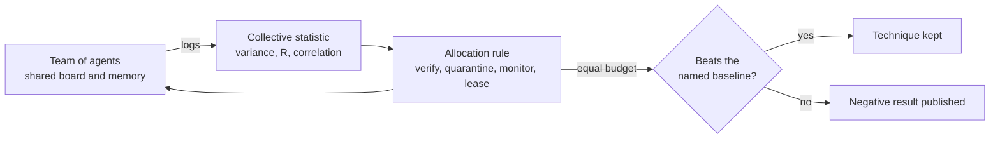

# TREMOR

**A research testbed for how AI agent teams coordinate, share memory, and catch errors.** We test
whether measurements of team behavior can guide where to spend verification, monitoring, and compute
at the same total cost.

[Preliminary results](#preliminary-results) · [Research lines](#eight-research-lines) ·
[Work plan](WORKPLAN.md) · [Scientific references](RESEARCH.md) ·
[60-second explainer](#see-it-in-60-seconds) · [Contact](#contact)

## Why I started TREMOR

This project grew out of more than two years of hands-on work with AI agents and years of work and
research on complex systems, artificial agents, and agent-based modeling. I’m increasingly interested
in what philosophy, psychology, sociology, political science, and complex-systems research can teach
us about evaluating and improving agent teams. Those fields offer ways to frame the questions, develop
practical heuristics, and design assessments for how teams coordinate, distribute responsibility, and
recover from errors.

Anthropic’s published research and the directions outlined for its Residency helped shape the agenda,
especially scalable oversight, AI control, and interpretability. Recent talks and conversations with
people at Anthropic at the AI Engineer Code Summit in San Francisco gave me concrete examples to
think through, including how agents coordinate over long tasks and what changes when they consolidate
memory. TREMOR is my independent research project.

— Alejandro Delmar

[AI Engineer Code Summit 2026](https://ai.engineer/code/2026) ·
[Lance Martin’s talk on coordination and memory](https://ai.engineer/code/2026/talks/lance-martin) ·
[Related research on memory and multi-agent teams](RESEARCH.md#agent-memory-and-multi-agent-coordination) ·
[Anthropic Residency research directions](https://alignment.anthropic.com/2026/anthropic-residency/)

## From scaling models to scaling teams

Language-model scaling studies showed how training loss changes with model size, training tokens,
and compute, and helped researchers decide how to allocate a training budget. Agent systems add
another problem of allocation. Given a budget for inference, tools and verification, who should
work on what, who can commit a decision, and when should another agent intervene? Studies of agent
systems already find that the value of coordination depends on the task and architecture. [Scaling and agent-system studies](RESEARCH.md#scaling-models-and-agent-systems)

TREMOR treats these questions as a complex-systems problem. When agents share a board or memory,
one agent's local action changes what others see and can do. A claim can prevent duplicate work or
block the only worker who can finish it. A verified note can let several agents combine partial
solutions. An unchecked note can turn one error into agreement across the team. These effects can
change with task dependencies, team size, and where decision authority sits. We will measure both
the work completed and the interaction traces that explain how it happened. [Collective behavior and emergence](RESEARCH.md#collective-behavior-and-emergence)

The **principal–agent problem** gives us a way to ask who sets the goal, who has the evidence and
authority to act, and who can check the outcome. The **trust ladder** makes delegation testable:
an agent may first propose an action, then earn a scoped permission through verified work. The
permission can expire or be revoked, and unresolved decisions can escalate to a lead or human.
We will measure both harmful over-grants and useful work blocked by an overly restrictive rule.
[Delegation, oversight, and trust](RESEARCH.md#delegation-oversight-and-trust)

The release standard draws on **Petri**, **Persona Vectors**, and **Subliminal Learning**, three
past Fellows projects featured in Anthropic’s Residency announcement. TREMOR aims to publish a
reusable evaluation bench, reproducible traces and scorers, controlled interventions, and a
held-out replication with clear limits on what the results establish.
[Residency research comparators](RESEARCH.md#residency-research-comparators)

## Preliminary results

**Pilot 3 selected shared task order. It also found that second-round replies can exceed the
experiment’s output limit.** EP-1, the confirmatory experiment, remains in draft.

| Check | What we observed |
|---|---|
| Scorer agreement | Two Python scorers and one Lean 4 scorer agreed on 10,000 seeded, scripted logs. This checks agreement on those logs. |
| QGrid simulator cross-check | QGrid's NumPy statevector simulator and TREMOR's independent gate-level simulator agreed on 329 statevectors across 65 Grover-search cases within the stated tolerances. This validates an offline instrument for a planned held-out task family. |
| First two pilots | Both stopped under predefined rules. The first exposed reply-budget pressure from hidden reasoning. The second exposed parsing failures when replies included prose before JSON. |
| Pilot 3 | Completed 30 episodes and 240 calls with zero voids or transport aborts. Shared task order was the only order that passed the predefined selection rule. |
| Reply-length clearance | 13 of 144 replies in the three EP-1 conditions exceeded the 150-token ceiling. All 13 came in round two and had prose before the JSON action array. The longest reply used 263 tokens. |
| Spark instrument calibration | Qwen3.5-4B completed two short local prompts. From container start through confirmed cleanup, the run took 83.24 seconds and used 0.023123 GPU-hours. This establishes the short calibration envelope. |
| L2 direct-relay controls | Two scripted CPU windows kept the same number of scheduled turns and decisions. Across two planted roots, the controls produced direct-relay counts of `[2, 0]` and `[0, 0]`. An interrupted window retained known usage and yielded no relay estimate. |

**What EP-1 will test.** How much of the benefit of enforcing *claim before work* in code can a short
instruction card recover? Pilot 3 selected a task order for that comparison. It did not estimate the
card’s effect. A revised second-round instruction has passed scripted checks and still needs
prospective review and live clearance. [Current workplan](WORKPLAN.md#where-we-are-2026-11-21)

## See it in 60 seconds

The opening scenes illustrate how agents share state, how a wrong note spreads, and where to place
verification and monitoring. Red lines show writes and green lines show reads. The closing
**Observed · Pilot 3** panel shows measured instrument results. The preliminary-results table above
provides a text version.

## In one paragraph

AI agents increasingly work in teams that share state: a task board, shared notes, a memory that is
consolidated overnight. A team like that is a **medium**. Work, errors and norms move through it, and it
has collective properties that no single agent has: how much its outcome wobbles between identical
reruns, how far a wrong note copies itself, how correlated its members' mistakes are, how fast it
recovers from a shock. TREMOR measures those properties from logs and turns each one into an
**algorithm that decides where scarce resources go**: verification, monitor calls, memory, permissions
and team structure. Every algorithm must beat a named baseline at equal budget, and every prediction
carries a criterion that can kill it.

## The problem

Agent teams are being deployed faster than they are understood. Their scarce resources are spent evenly
or by habit:

| Today | The question we ask |
|---|---|
| Every piece of work is reviewed once, whatever its risk | Which work is fragile, and can we tell before it fails? |
| Monitors are stacked until it feels safe | How many *independent* checks do five monitors really give? |
| Shared memory is consolidated ("dreamed") overnight | When does consolidation correct errors, and when does it amplify them? |
| One bad note can reach every agent through shared memory | Is there an epidemic threshold, and what share of verified notes stops it? |
| Permissions are granted once and kept forever | Can trust widen and expire on evidence instead? |
| Teams grow, and coordination quietly collapses | How does the effective number of agents scale with team size? |

Each of these is a safety question as much as a performance question. A team that spends oversight
blindly misses the failures that matter.

## The thesis

**Measure the team's response, then allocate by it.** For each scarce resource there is a collective
statistic that says where the resource matters. A rule that spends by that statistic should beat a rule
that ignores it, at equal budget and with the cost of measuring charged against it.

## Eight research lines

Each line takes one idea from complex systems or first principles, turns it into a statistic read from
logs, and turns the statistic into a technique.

| # | Line | Idea | Statistic | Technique | Baseline it must beat |
|---|---|---|---|---|---|
| 1 | Susceptibility-guided orchestration | Fluctuation and response | Rerun overdispersion against dose response | Verify where the measured response is highest | Verify where reruns disagree; equal-token retries |
| 2 | Memory immune system | Epidemic threshold, herd immunity | Reproduction number R of a wrong note | Provenance, quarantine, verify highest-R notes first | One-line warning; corroboration; graph-degree order |
| 3 | Correlation-aware monitor ensembles | Redundancy and coding | Joint misses of monitor views | Rotating hidden view under selection pressure | Published selection rules; conservative aggregation |
| 4 | Dreaming as error-correcting consolidation | Iterated map with a threshold; critical slowing down | False-note share and recovery time across nights | Verified replay with adaptive strength | Equal-token search; placebo dream; gated write |
| 5 | Stigmergic coordination and norm carriers | Marks that evaporate; where a norm lives | Violations per carrier on held-out norms | Evaporating claims; the carrier surface | Lease timeout; the rule enforced in code |
| 6 | Trust and permission calibration | Feedback control, sequential testing | Over-grant exposure | Evidence leases | Tuned fixed rule; time-boxed grant |
| 7 | Renormalization across team size | Coarse-graining | Error correlation as teams grow | Blocks sized by task coupling | Parallel small teams; single hub |
| 8 | Activation readouts | Two measurements of one event | Probe-to-text error correlation | A probe as one more ensemble view | Text monitors; published probe designs |

<b>What each line predicts, and what would kill it</b>

- **1. Susceptibility.** Across many conditions, a team's natural rerun variance predicts its response to
  a small push, after removing the part that is automatic for yes/no outcomes. Killed if the correlation
  is weak or adds nothing over team size alone.
- **2. Immune system.** A wrong note has a measurable reproduction number; above a threshold it spreads,
  below it dies out; targeted verification lowers R more than equal-cost alternatives. Killed if the
  reduction's interval includes zero at the planned sample size.
- **3. Monitors.** Views that differ behave like more independent monitors than copies of one view, and a
  rotating hidden view resists selection pressure. Killed if the gain stays below a few points.
- **4. Dreaming.** Above a consolidation strength, the share of false notes stops falling and grows; recovery
  slows before the flip. Killed if the dream is indistinguishable from a placebo dream at every level.
- **5. Stigmergy.** Evaporating claims recover most of what a rule enforced in code achieves, and some norms
  survive better in memory or environment than in instructions. Killed if no better than random task order.
- **6. Trust.** Evidence leases cut over-granted permissions without blocking more legitimate work.
- **7. Team size.** The effective number of independent agents grows slower than team size, and blocks
  sized by measured coupling do better than fixed structures. Killed if the scaling exponent is 1.
- **8. Activations.** A readout from activations alone does not beat a text monitor, but its errors are
  uncorrelated enough to improve the ensemble. Killed if the ensemble gain stays below two points.

Every prediction has three outcomes: supported, killed or inconclusive. A result that is merely not
significant is inconclusive, never killed.

## Two further research lines: R5 and R6

Besides the eight lines above, the lab has two planned lines. Both are plans: they are not frozen, and
no agent has been run on either.

**R5, agent performance testing.** Lines 1 to 8 test allocation rules against baselines. R5 asks two
other questions: can a team's task performance be forecast out of sample, and is what a team reports
about itself accurate? Its primary test (H2) fits a simple common-cause model on small teams (2 and 4
agents) and checks how well it forecasts the distribution of the number of agents that pass at 8
agents. The secondary tests ask whether team confidence outruns team accuracy and whether best-of-N
selection buys fewer than N independent draws. The planned local model is **Inkling-2-Mini**, run on the
Spark GPU. TREMOR has not contacted it; only an offline client and driver exist. Plan:
[`prereg/R5-agent-performance-line-plan.md`](prereg/R5-agent-performance-line-plan.md).

**R6, a P vs NP multi-lens research line.** R6 does not claim a proof of P = NP or P != NP and gives no
probability of resolving the question. It has two parts:

- *A research framework.* Six lenses (circuits and algorithms-to-lower-bounds, algebraic complexity,
  meta-complexity, proof complexity, fine-grained complexity, descriptive complexity), a check of each
  candidate argument against the three known barriers (relativization, natural proofs, algebrization),
  and a JSON scorecard. Two lenses are chosen for work here: circuits as the lower-bound route and
  meta-complexity as an instrument. Both use one object, a truth table with its exact minimum circuit
  size, so every finite claim can be checked exhaustively.
- *A scored task suite for agents.* Tasks with mechanical ground truth, decided by a program and never by
  a judge model: SAT and model counting, circuit size, circuit-size decision, small resolution
  refutations, lemma checking, and definition audit. Tables of exact formula and circuit sizes for small
  functions, computed by our own exact solver, provide the ground truth. Two scored arms sit on top: a
  **Red Team** arm (does a "refute this" role reduce false lemmas that are still accepted, against an
  ordinary solver role at the same calls and tokens?) and a **Definition Audit** arm (can an agent tell
  a faithful formal statement from a defective one, and locate the defect?).

Claims from R6 are about how agents do on these tasks, never about P vs NP. Plan:
[`prereg/R6-pvsnp-research-line-plan.md`](prereg/R6-pvsnp-research-line-plan.md). Background and
references: [RESEARCH.md](RESEARCH.md#research-background-for-the-r5-and-r6-lines).

## The shared instrument

All eight lines run on one bench, so their results can be compared and combined.

- **A shared task board** with claims, work and releases, run by teams of four agents and up.
- **Deterministic scoring from logs.** Three independently written scorers must agree on every episode.
  One is written in **Lean 4**, and its soundness properties are proved and checked by the Lean kernel
  (66 theorems, standard axioms only, no `sorry`). Any disagreement voids the run.
- **Seeded shocks and planted notes** with clean twins as controls, so responses and contagion can be
  measured rather than guessed.
- **A quantum circuit simulator** that runs locally using classical statevectors. Its JSON output
  compares each step of Grover search with an analytic reference. The planned held-out task family
  will use this tool to test whether coordination effects transfer beyond arithmetic tasks.
  [Run the simulator and read the QGrid cross-check](RESEARCH.md#qgrid-and-the-quantum-simulator)
- **Hard spend limits in code**, with a ledger checked before and after every model call and runs that
  stop themselves on pre-written rules.
- **Two kinds of models:** hosted Claude models at small and frontier tiers, and open-weight models run
  on a local workstation GPU for the memory and activation experiments.

## What exists today

| Part | Status |
|---|---|
| Task board, router, practice cards, perturbation and planted-note tools | Built; checked on scripted agents |
| Three agreeing scorers, one proved in Lean 4 | Built; 0 disagreements on 10,000 seeded logs |
| Spend ledger with hard caps | Built; independent reviews plus tests that break it on purpose |
| First calibrated measurement: an instruction card against the same rule enforced in code | Preregistration drafted, awaiting clearance and freeze |
| Research lines 1 to 8 | Designed. L2 has scripted relay controls. Confirmatory runs are pending. |

### Can leadership move with the work?

An additional experiment compares independent contributors, a fixed orchestrator, rotating lead/helper
roles, and local coordination through shared claims. We’ll measure verified output at equal total
cost, including coordination and verification. The comparison for emergence is the verified,
deduplicated output of the same number of independent contributors. This is a planned test within
the coordination and team-size research lines.

## Roadmap

| When | Focus | Deliverable |
|---|---|---|
| Week 0 | Close the instrument gates; first calibrated measurement | That measurement's result, whatever it is |
| Week 1 | Overnight consolidation loop; scripted controls for all lines | Instrument report; controls that must fail and must pass |
| Week 2 | Variance pilot; one pre-registration per line | Frozen pre-registrations, published before any run |
| Weeks 3 to 4 | Lines 1 to 3 on local and small hosted models | The three techniques against their baselines |
| Week 5 | Dreaming phase map; evaporating claims; pilots of lines 6 to 8 | Consolidation results; pilot tables |
| Week 6 | Write-up and release | Bench, logs, Lean oracle, analysis code, reference techniques, every negative result |
| Months 2 to 6 | Replication on a second open model family; external benchmarks; one combined controller | Paper and benchmark v1 |

The full work plan, with gates and rules, is in **[WORKPLAN.md](WORKPLAN.md)**.

## Findings so far

Only recorded facts are listed here. None of them is a result about whether any technique works.

**Accepted.** Milestone M1, a small GPU calibration on the Spark, is accepted: 0.023123 GPU-hours
settled. That is 1 of 10 milestones. The paid total is USD 0.00 against a hard USD 10 cap enforced in
code.

**The two-implementation rule.** A label or ground-truth value is used only when two independent
implementations agree on it. A single implementation is not enough.

**What review found.** Every code change is checked by a fresh reviewer, and reviewers also attack the
tests with mutation checks (deliberately broken copies of the code that the tests must catch).
Recorded outcomes from the lab's status log:

- One gap review of the new work: 4 wording and stale-document findings fixed, 1 low-severity surviving
  mutant then killed, 1 equivalent mutant accepted, and 22 of 24 new mutants killed.
- The sandbox extension was first returned for revision (survivors in a rank cap and a lower
  bound, and in `scorer_ids`), fixed, and accepted on the second review.
- The R6 task-family code (T2) was returned for revision. Three real mutant survivors (bits=1, limit-1,
  an unreduced coefficient) are now all killed on a scratch copy; two further mutants are equivalent. The
  fixed version was not re-reviewed in full.

**Not run.**

- No agent has run on R5 or R6.
- Inkling-2-Mini has not been contacted. Only the offline client and driver exist.
- No paid batch has run.
- No run has started for any milestone beyond M1. M2 to M10 each wait on a named person (key holder,
  trainer price, placement, line authors or custodian, or the owner).

**Limits.** The offline checks show that scorers, gates and generators behave as designed on scripted
inputs. They are not evidence about any model. Test and mutation counts show that the checks caught what
they were aimed at, not that nothing else is wrong. The checklist is 24 lines done and 15 open; all 15 are
waiting on a named person or an owner decision, not on lane work.

## What would falsify the whole programme

1. **No repeatable response:** a statistic measured on one set of seeds does not predict itself on another.
2. **Allocation never helps:** the techniques fail against uniform, random or tuned baselines at equal budget.
3. **No dose-response and no thresholds:** the complex-systems ideas add nothing over ordinary ablations.

Scripted agents provide a separate boundary test. If they reproduce an effect, we can study which
parts of the coordination mechanism are sufficient to produce it.

If the predictions fail, we publish the negative results and keep the bench.

## How the work is done

The project is run by a team of AI models with separate roles: planning and pre-registration,
orchestration and verification, implementation, and retrieval, with a human owner who approves every
spend and every publication. Every code change is checked by a fresh reviewer that did not write it.
Every claim about outside work is checked against its source. **Reviews police claims and evidence,
never the scope of the questions.**

## What this is not

- Not a claim that any of these techniques works. They are hypotheses with kill criteria.
- Not evidence about frontier systems in general. Results hold for the models and tasks tested, and the
  first tasks are deliberately simple.
- Not offensive security work. Contagion and poisoning experiments use benign stand-ins, under a
  dual-use boundary written down before any run.

## Lab, tooling and progress (offline, local-first)
This repository is the TREMOR project: the public write-up above plus the working lab that builds and
tests the experiments. TREMOR is the only project name. Some internal names still say "murmuration"
because they are pinned: the Python package `src/murmuration/`, the environment variable
`MURMURATION_EP1_KEY`, and `src/murmuration` paths inside the preregistrations (`prereg/`) and the
Pilot 4 preflight manifest. Renaming them changes the sha256 of files that the admission record and the
freeze records pin, so it is a planned step with a re-pin, not a quiet find-and-replace (see
`docs/reports/tremor/RENAME_TO_TREMOR_PLAN.md`).

- **Status:** only milestone M1 (a small GPU calibration) is accepted, 1 of 10. No agent has been run on
  the R5/R6 lines yet; the paid total is USD 0.00 against a hard USD 10 cap enforced in code.
- **Built and tested offline:** the money guard (`src/murmuration/spend.py`, `ep1.py`), the admission gate
  and sealed inputs (`lab/tremor_*`), the R6 task families and scoring (`lab/r6_*`), and offline
  rehearsals of the gate and of the R6 pipeline. Each has tests and mutation checks.
- **Plan and checklist:** `docs/reports/TREMOR_GOAL_AND_PLAN_20261123.md`; handoff:
  `docs/reports/HANDOFF_TREMOR_20261126.md`; review evidence:
  `docs/reports/tremor/REVIEW_ITEMS_ATTACK_EVIDENCE.md`.
- **Not done:** Pilot 4 and EP-1 (waiting on a key holder), any Inkling-2-Mini GPU run on the Spark,
  custodian-held sealed inputs, and any run for M2 to M10.
- **Two `quantum` packages:** the public simulator is `quantum/` at the root (run its tests with `PYTHONPATH=. python3 -m unittest tests.test_gatesim`); the lab has its own `lab/quantum/`. With `lab` on the Python path, as the lab test commands do, `lab/quantum` shadows the root package, so run the two sets of tests separately.
- **Original lab README** (permission replay ledger, safety and privacy notes): `docs/LAB_README.md`.
- The VP != VNP paper shared on 2026-11-23 is used only as a source of finite test tasks. Its proof is not
  verified by us, and nothing here supports a claim about P vs NP.

## Contact

Alejandro Delmar · [adelmar@seabridge.ai](mailto:adelmar@seabridge.ai)
