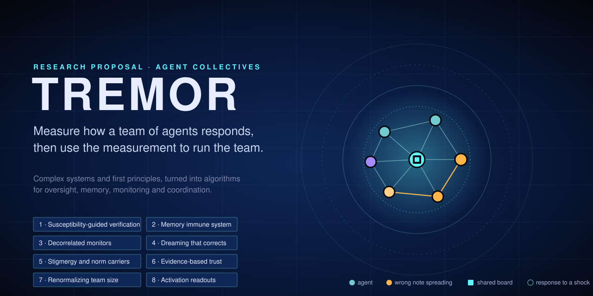
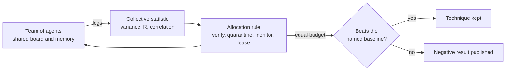

<b>Measure how a team of agents responds, then use the measurement to run the team.</b> 
Research proposal · complex systems and first principles for AI agent teams · <a href="WORKPLAN.md">Work plan</a>

---

## In one paragraph

AI agents increasingly work in teams that share state: a task board, shared notes, a memory that is
consolidated overnight. A team like that is a **medium**. Work, errors and norms move through it, and it
has collective properties that no single agent has: how much its outcome wobbles between identical
reruns, how far a wrong note copies itself, how correlated its members' mistakes are, how fast it
recovers from a shock. TREMOR measures those properties from logs and turns each one into an
**algorithm that decides where scarce resources go**: verification, monitor calls, memory, permissions
and team structure. Every algorithm must beat a named baseline at equal budget, and every prediction
carries a criterion that can kill it.

> **Status.** Research proposal plus a working, verified instrument. **No hypothesis has been tested
> yet and no result here is a finding.** Failures will be published alongside successes.

## The problem

Agent teams are being deployed faster than they are understood. Their scarce resources are spent evenly
or by habit:

| Today | The question we ask |
|---|---|
| Every piece of work is reviewed once, whatever its risk | Which work is fragile, and can we tell before it fails? |
| Monitors are stacked until it feels safe | How many *independent* checks do five monitors really give? |
| Shared memory is consolidated ("dreamed") overnight | When does consolidation correct errors, and when does it amplify them? |
| One bad note can reach every agent through shared memory | Is there an epidemic threshold, and what share of verified notes stops it? |
| Permissions are granted once and kept forever | Can trust widen and expire on evidence instead? |
| Teams grow, and coordination quietly collapses | How does the effective number of agents scale with team size? |

Each of these is a safety question as much as a performance question. A team that spends oversight
blindly misses the failures that matter.

## The thesis

**Measure the team's response, then allocate by it.** For each scarce resource there is a collective
statistic that says where the resource matters. A rule that spends by that statistic should beat a rule
that ignores it, at equal budget and with the cost of measuring charged against it.

## Eight research lines

Each line takes one idea from complex systems or first principles, turns it into a statistic read from
logs, and turns the statistic into a technique.

| # | Line | Idea | Statistic | Technique | Baseline it must beat |
|---|---|---|---|---|---|
| 1 | Susceptibility-guided orchestration | Fluctuation and response | Rerun overdispersion against dose response | Verify where the measured response is highest | Verify where reruns disagree; equal-token retries |
| 2 | Memory immune system | Epidemic threshold, herd immunity | Reproduction number R of a wrong note | Provenance, quarantine, verify highest-R notes first | One-line warning; corroboration; graph-degree order |
| 3 | Correlation-aware monitor ensembles | Redundancy and coding | Joint misses of monitor views | Rotating hidden view under selection pressure | Published selection rules; conservative aggregation |
| 4 | Dreaming as error-correcting consolidation | Iterated map with a threshold; critical slowing down | False-note share and recovery time across nights | Verified replay with adaptive strength | Equal-token search; placebo dream; gated write |
| 5 | Stigmergic coordination and norm carriers | Marks that evaporate; where a norm lives | Violations per carrier on held-out norms | Evaporating claims; the carrier surface | Lease timeout; the rule enforced in code |
| 6 | Trust and permission calibration | Feedback control, sequential testing | Over-grant exposure | Evidence leases | Tuned fixed rule; time-boxed grant |
| 7 | Renormalization across team size | Coarse-graining | Error correlation as teams grow | Blocks sized by task coupling | Parallel small teams; single hub |
| 8 | Activation readouts | Two measurements of one event | Probe-to-text error correlation | A probe as one more ensemble view | Text monitors; published probe designs |

<b>What each line predicts, and what would kill it</b>

- **1. Susceptibility.** Across many conditions, a team's natural rerun variance predicts its response to
  a small push, after removing the part that is automatic for yes/no outcomes. Killed if the correlation
  is weak or adds nothing over team size alone.
- **2. Immune system.** A wrong note has a measurable reproduction number; above a threshold it spreads,
  below it dies out; targeted verification lowers R more than equal-cost alternatives. Killed if the
  reduction's interval includes zero at the planned sample size.
- **3. Monitors.** Views that differ behave like more independent monitors than copies of one view, and a
  rotating hidden view resists selection pressure. Killed if the gain stays below a few points.
- **4. Dreaming.** Above a consolidation strength, the share of false notes stops falling and grows; recovery
  slows before the flip. Killed if the dream is indistinguishable from a placebo dream at every level.
- **5. Stigmergy.** Evaporating claims recover most of what a rule enforced in code achieves, and some norms
  survive better in memory or environment than in instructions. Killed if no better than random task order.
- **6. Trust.** Evidence leases cut over-granted permissions without blocking more legitimate work.
- **7. Team size.** The effective number of independent agents grows slower than team size, and blocks
  sized by measured coupling do better than fixed structures. Killed if the scaling exponent is 1.
- **8. Activations.** A readout from activations alone does not beat a text monitor, but its errors are
  uncorrelated enough to improve the ensemble. Killed if the ensemble gain stays below two points.

Every prediction has three outcomes: supported, killed or inconclusive. A result that is merely not
significant is inconclusive, never killed.

## The shared instrument

All eight lines run on one bench, so their results can be compared and combined.

- **A shared task board** with claims, work and releases, run by teams of four agents and up.
- **Deterministic scoring from logs.** Three independently written scorers must agree on every episode.
  One is written in **Lean 4**, and its soundness properties are proved and checked by the Lean kernel
  (66 theorems, standard axioms only, no `sorry`). Any disagreement voids the run.
- **Seeded shocks and planted notes** with clean twins as controls, so responses and contagion can be
  measured rather than guessed.
- **Hard spend limits in code**, with a ledger checked before and after every model call and runs that
  stop themselves on pre-written rules.
- **Two kinds of models:** hosted Claude models at small and frontier tiers, and open-weight models run
  on a local workstation GPU for the memory and activation experiments.

## What exists today

| Part | Status |
|---|---|
| Task board, router, practice cards, perturbation and planted-note tools | Built; checked on scripted agents |
| Three agreeing scorers, one proved in Lean 4 | Built; 0 disagreements on 10,000 seeded logs |
| Spend ledger with hard caps | Built; independent reviews plus tests that break it on purpose |
| First calibrated measurement: an instruction card against the same rule enforced in code | Pre-registered, not yet frozen |
| Research lines 1 to 8 | Designed; not started |

**Instrument pilots so far.** Two short pilots on a small Claude model each stopped themselves on a rule
written in advance. The first showed that hidden reasoning was using up the reply budget. The second,
with reasoning turned off, showed the model writing its reasoning as prose before a correct answer.
Both are instrument findings, being fixed before any measurement. Neither is a result.

**Early observation (not evidence).** Identical agents herd: in the pilots, all four agents often
claimed the same first task. Giving each agent its own task order removed duplicate work in a handful
of episodes. Herding is the kind of collective effect this project is about, and line 5 studies it.

## Roadmap

| When | Focus | Deliverable |
|---|---|---|
| Week 0 | Close the instrument gates; first calibrated measurement | That measurement's result, whatever it is |
| Week 1 | Overnight consolidation loop; scripted controls for all lines | Instrument report; controls that must fail and must pass |
| Week 2 | Variance pilot; one pre-registration per line | Frozen pre-registrations, published before any run |
| Weeks 3 to 4 | Lines 1 to 3 on local and small hosted models | The three techniques against their baselines |
| Week 5 | Dreaming phase map; evaporating claims; pilots of lines 6 to 8 | Consolidation results; pilot tables |
| Week 6 | Write-up and release | Bench, logs, Lean oracle, analysis code, reference techniques, every negative result |
| Months 2 to 6 | Replication on a second open model family; external benchmarks; one combined controller | Paper and benchmark v1 |

The full work plan, with gates and rules, is in **[WORKPLAN.md](WORKPLAN.md)**.

## What would falsify the whole programme

1. **No repeatable response:** a statistic measured on one set of seeds does not predict itself on another.
2. **Allocation never helps:** the techniques fail against uniform, random or tuned baselines at equal budget.
3. **No dose-response and no thresholds:** the complex-systems ideas add nothing over ordinary ablations.
4. **Scripted agents reproduce everything:** the effects are about loops, not about language models.

If all four hold, we publish the negatives and keep the bench.

## How the work is done

The project is run by a team of AI models with separate roles: planning and pre-registration,
orchestration and verification, implementation, and retrieval, with a human owner who approves every
spend and every publication. Every code change is checked by a fresh reviewer that did not write it.
Every claim about outside work is checked against its source. **Reviews police claims and evidence,
never the scope of the questions.**

## What this is not

- Not a claim that any of these techniques works. They are hypotheses with kill criteria.
- Not evidence about frontier systems in general. Results hold for the models and tasks tested, and the
  first tasks are deliberately simple.
- Not offensive security work. Contagion and poisoning experiments use benign stand-ins, under a
  dual-use boundary written down before any run.

## Inspiration

The problems were shaped by four talks at the AI Engineer Code Summit 2026, on thousand-agent teams,
memory and dreaming, bounded autonomy, trust, and reliability; by the complex-systems literature on
fluctuation and response, epidemics, stigmergy and renormalization; and by published research
directions in AI safety on oversight, model organisms, interpretability and agent behaviour.

## Contact

[owner to add]
